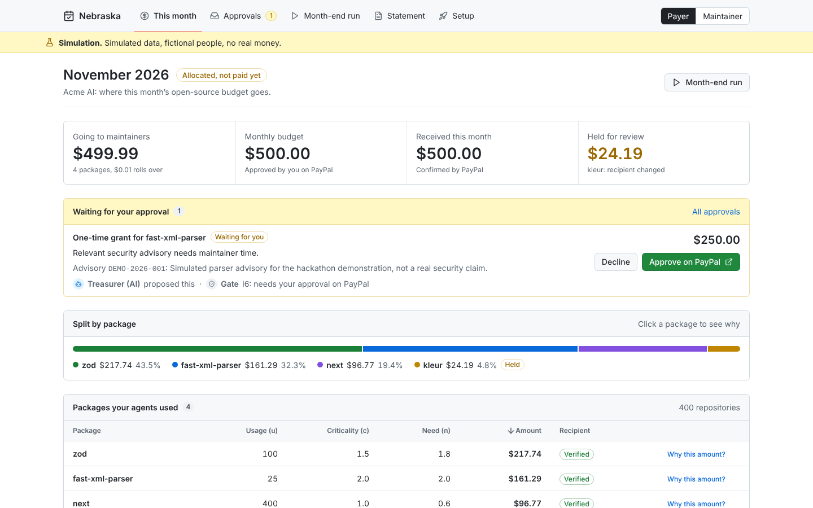
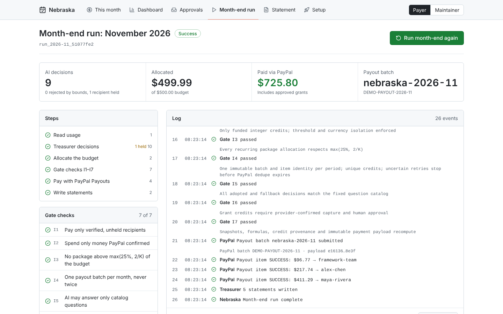
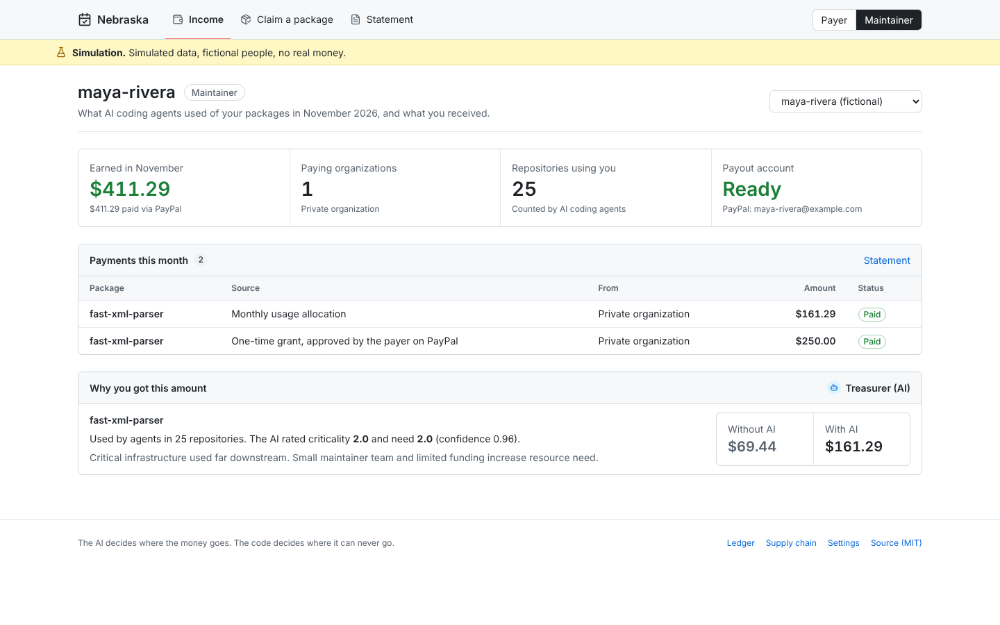

# Nebraska

**Nebraska is a hosted service that pays the open-source maintainers behind your AI coding agent's dependencies, every month, by actual usage, through PayPal.**

> AI is the first user of open source that knows exactly who it owes.
>
> The AI decides where the money goes. The code decides where it can never go.
>
> You can still choose not to pay. You just can't say you didn't know.

- **Hosted app (PayPal sandbox mode):** https://nebraska-paypal-ai-hackathon.onrender.com
- **Demo video (under 3 minutes):** see the Devpost submission page
- **Source:** https://github.com/davidlueng986-alt/nebraska-paypal-ai-hackathon (MIT)



## How it works

1. **Payer (a company or developer using coding agents)** approves a monthly budget on PayPal (Subscriptions, quantity = USD), then adds one hook line to their agent. The hook records which packages the agent actually uses, at what dependency depth, without uploading source code.
2. **Maintainers** claim their package with GitHub, bind a PayPal email and receive monthly payouts. They never pay anything.
3. **Month-end:** an AI Treasurer asks typed questions about each package (`criticality`, `need`, `payee_risk`, `grant_case`). A deterministic allocator turns the answers into cents. A policy gate enforces seven invariants (I1–I7) before PayPal is called. PayPal Payouts pays everyone in one batch. Both sides get a statement they can recompute.

The only human actions are approving the budget and approving any extra grant, **both on PayPal's own pages**. The AI can propose a grant; it can never approve one.

| Month-end run (I1–I7 as live checks) | Maintainer income |
|---|---|
|  |  |

## Try it in 3 minutes (no credentials, local demo mode)

Requires **Node.js 24+**. SQLite ships with Node; nothing else to install.

```bash
git clone https://github.com/davidlueng986-alt/nebraska-paypal-ai-hackathon.git
cd nebraska-paypal-ai-hackathon
npm ci
npm run build && npm start      # or: npm run dev
```

Open http://localhost:3000. Demo mode is the default: no PayPal call is made, and all identities (for example "Maya") are fictional.

1. **This month** (`/`): a $500 budget split across four packages: **$96.77 / $217.74 / $161.29 / $24.19**. One cent is recycled to next month. Open **Why this amount** on `fast-xml-parser`: **$69.44 with neutral AI weights → $161.29 with AI judgment**.
2. **Approvals** (`/approvals`): approve the proposed **$250** security grant. In demo mode this opens a page labelled "Simulated approval page"; in sandbox mode it is PayPal's own approval page.
3. **Month-end** (`/month-end`): run it. You will see the usage snapshot, typed decisions, a README prompt injection rejected to the neutral weight, a `payee_risk` hold on a recipient whose email changed yesterday, I1–I7 passing one by one, and batch `nebraska-2026-11`.
4. **Maintainer** (`/maintainer`): Maya receives $161.29 recurring + $250.00 grant = **$411.29**.
5. Run month-end **again**: the same batch ID comes back. No second payment.

Deterministic replay for screen recording: `/month-end?replay=fixture`.

Command-line checks:

```bash
npm run demo        # full month in an isolated in-memory ledger, writes artifacts/demo-result.json
npm run recompute -- artifacts/demo-result.json   # independent recomputation
npm run check       # typecheck, 54 unit tests, production build
npm run check:api   # real route handlers, including the month-end SSE stream and replay
npm run check:mcp   # real MCP stdio transport
```

## Hosted sandbox (for judges)

The hosted app runs with `NEBRASKA_MODE=sandbox` against `api-m.sandbox.paypal.com` (the adapter cannot target live PayPal). Sandbox pages need a workspace sign-in at `/signin`.

| What | Value |
|---|---|
| Workspace sign-in token (sandbox only) | ⚠️ TO FILL before submission |
| PayPal sandbox payer (personal) login | ⚠️ TO FILL before submission |
| PayPal sandbox maintainer (personal) login | ⚠️ TO FILL before submission |

These are PayPal **sandbox** test accounts only; they hold no real money.

## What is real and what is simulated

| | Status |
|---|---|
| Allocator, I1–I7 gate, immutable batch identity, ledger | Implemented and covered by automated tests (54 unit tests, API and MCP transport checks, PostgreSQL concurrency checks) |
| Local demo mode | **Simulated:** no PayPal calls; decisions come from a deterministic rules provider labelled `demo-rules-1 (simulation)`; identities and funding signals are fictional |
| Hosted deployment | Live on Render in sandbox mode (`/api/health` returned `mode: sandbox` on 2026-11-12) |
| PayPal sandbox app | OAuth client-credentials verified on 2026-11-12; the token carries the Payouts, Subscriptions and Webhooks scopes; the Payouts API is reachable. Webhook registered for 14 event types |
| End-to-end sandbox month (subscription → Payouts → webhooks) | Not yet recorded as evidence in this repository |
| Runtime model | Integrated (OpenAI-compatible API; configured for DeepSeek V4.1 Flash via OpenCode Zen). No successful inference was observed before submission because the model account had no credit; without a model answer, decisions fall back to the neutral weight 1.0 with confidence 0 |
| Cooldown | 14 days. A sandbox-only `DEMO_COOLDOWN_MINUTES` override exists; it is impossible to enable outside sandbox mode and the UI shows a permanent "Demo: cooldown shortened" badge when it is on |

## The money model

```
u_i = Σ over repositories of 0.5 ^ (minimum dependency depth this month)
w_i = sqrt(u_i) × criticality_i × need_i
```

- AI weights are bounded to `[0.5, 2]` and revert to `1` below 80 % confidence. Out-of-range answers are rejected, not clamped.
- Each package is capped at `max(25 %, 2/K)` of the payer's confirmed pool; the excess is redistributed.
- Amounts round **down** to the cent; the remainder returns to the payer's next month.
- Balances under 10 units roll forward. Unclaimed funds return after six months. New claims, email changes and fiscal-host changes wait 14 days.
- Extra grants use a separate human-approved PayPal order and are outside the recurring cap.

## Seven enforced invariants

| Gate | Boundary |
|---|---|
| I1 | Verified recipient, valid claim, cooldowns complete, no active hold |
| I2 | Allocations ≤ confirmed receipts; payout amounts equal funded integer-cent credits; currencies isolated |
| I3 | Every recurring package respects the payer's cap |
| I4 | One `nebraska-{period}` batch; immutable items and payload; item IDs include currency; retries reuse the same ID |
| I5 | Every decision matches the fixed question catalog's types and bounds |
| I6 | Grant credits require provider-confirmed human approval and capture |
| I7 | Frozen usage, decisions and parameters recompute the allocation; every payout traces to credits |

A timeout never creates a new batch: credits are reserved before the call, and the exact payload is retried under the same `sender_batch_id`.

## Run against your own PayPal sandbox

Copy `.env.example` to `.env`, set `NEBRASKA_MODE=sandbox` and fill in your sandbox app credentials, webhook ID and model endpoint. [docs/SANDBOX.md](docs/SANDBOX.md) walks through the PayPal app, webhook events, GitHub OAuth and the model. [render.yaml](render.yaml) deploys the web service, Postgres and the daily worker.

## For agent and CI integrations

- Agent hook: [examples/claude-hooks.json](examples/claude-hooks.json)
- MCP server (`npm run mcp`): `record_usage`, `budget_status`, read-only `explain_allocation` and resource `nebraska://statements/{period}`. No MCP tool can move money. [examples/mcp.json](examples/mcp.json)
- GitHub Action: [action.yml](action.yml) · Meter: `npm run meter -- --root <repo> --dry-run` ([docs/METER.md](docs/METER.md))
- Live month-end stream: `POST /api/month-end/runs`, then `GET /api/month-end/runs/{id}/events` (Server-Sent Events, `?replay=1`). Contract: [contracts/month-end-run.schema.json](contracts/month-end-run.schema.json)

More: [API](docs/API.md) · [Architecture](docs/ARCHITECTURE.md) · [Security](docs/SECURITY.md) · [Features](docs/FEATURES.md) · [Video notes](docs/VIDEO.md) · [繁體中文快速開始](docs/QUICKSTART.zh-Hant.md)

## AI disclosure

- **Built with AI assistance:** OpenAI Codex and Anthropic Claude were used for design, planning and implementation.
- **Runtime AI:** the decision provider and the Treasurer call an OpenAI-compatible chat-completions model with structured output (configured: DeepSeek V4.1 Flash through OpenCode Zen). The model only answers a fixed set of typed questions; it never sees payment credentials and cannot approve, enlarge or redirect a payment. The model ID returned by the provider is stored with every decision.
- **Local demo decisions are simulated** by a deterministic rules provider and are labelled as such.
- **Video narration** uses synthetic voices (Kokoro-82M, Apache-2.0); music and sound are synthesized. Details in [docs/VIDEO.md](docs/VIDEO.md).

## Scope and limits

Nebraska does not force anyone to pay, does not convert currencies, and is not a licensed money transmitter. The competition build supports PayPal **sandbox** only. Policy parameters are starting assumptions, not calibrated findings.

Licensed under [MIT](LICENSE).
