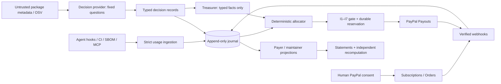
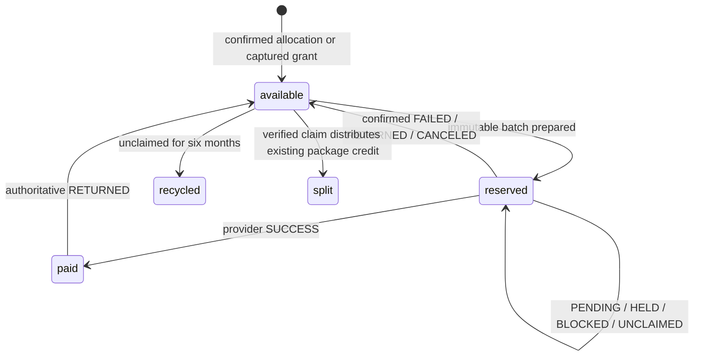

# Architecture and implementation decisions

Nebraska connects deterministic usage facts to bounded model judgments and authenticated PayPal sandbox settlement.

## Boundaries

- **Meter:** package coordinates, source signal, salted repository hash, session, observation time and depth. No source code reaches the server.
- **Decision layer:** the only model component that sees untrusted README/advisory content. A fixed catalog and JSON schema constrain answers. Errors, invalid responses and low confidence normalize to defaults. Records retain the normalized value, acceptance, confidence, reason, model version and input hash.
- **Treasurer:** an actual function-calling agent in configured sandbox mode. Tool definitions are fixed; period is bound by the caller rather than supplied by the model. It cannot release holds or capture/approve orders. Tool results omit raw package text and model-authored free-form reasoning. Calls have a 32-step maximum. Workflow mode is available for demonstrations or deterministic operational scheduling.
- **Gate/service:** the trusted money boundary. Provider secrets are used only by trusted integrations and never enter model messages. Before submitting a payout, the service validates all invariants and commits reservations to durable storage.
- **Provider:** sandbox-only PayPal adapter. A separate deterministic provider simulates transactions. Their databases are separated by default.

## Append-only journal instead of mutable business tables

The design’s logical tables are collections in a replayed state. Every change writes an entire new entity version into `journal`; it never updates or deletes an existing event. Entries contain a contiguous sequence, event ID, collection, canonical payload, timestamp, previous digest and SHA-256 digest. Triggers reject UPDATE and DELETE in both SQLite and Postgres.

SQLite uses `BEGIN IMMEDIATE`. Postgres uses an advisory transaction lock, shared by web and cron writers, followed by replay and atomic insertion. Provider/network operations run **outside** the transaction. Projection state can be rebuilt from the journal and is not the authority on its own.

This implementation favors inspectability at hackathon scale. Replay is linear in journal size. A production deployment should add verified checkpoints and indexed read models while preserving the journal, and use a separate restricted database role for append-only application access. A database superuser is outside the current threat model and can disable triggers; a hash chain is tamper evidence, not an externally signed anchor.

Logical collections: `orgs`, `packages`, `maintainers`, `claims`, `receipts`, `usages`, `decisions`, `closes`, `credits`, `holds`, `grants`, `batches`, `statements`, `audits`, `hosts`, `subscriptions`, `webhooks`. Minimum-depth usage units are derived from immutable raw observations; they are never supplied by the model.

## Settlement state machine

1. Complete model judgments. Changed or uncertain recipients are held by domain code even if the Treasurer omits a hold tool call.
2. Freeze a close per organization/period, including actual receipt pool, raw usage snapshot, selected decisions and parameter version.
3. Allocate the recurring pool. Split cents to verified claimants, or keep a package credit unclaimed. Recycle unused/rounding cents into the next month.
4. Aggregate available credits by maintainer/currency across all prior periods up to the closing period. Exclude ineligible recipients and subminimum balances.
5. Compute one immutable global period batch. Gate it; persist the batch and all reservations before calling PayPal.
6. On ambiguous failure, leave reservations intact. Repeat the exact batch and payload within 29 days. On duplicate-batch provider errors, recover the original provider batch through its validated self link. Never generate another identity.
7. Signature-verified notifications trigger authoritative status queries. Success pays credits; confirmed return/failure/cancellation restores them; in-flight statuses remain reserved.
8. Write statements. Returning funds can only participate in a later period batch. Already-prepared batches never acquire new credits.

Statuses:

## Clarifications to the original documents

| Decision | Implementation | Reason |
|---|---|---|
| D-13 cent rounding | Floor package allocation cents; recycle the residual | The required sample sums to $499.99, not $500.00 |
| D-14 P2 item identities | Hashed maintainer + period + currency | Preserves one period batch while supporting multiple currencies and PayPal field limits |
| D-15 multi-currency | Separate funded pools in USD/EUR/GBP/CAD/AUD; no FX | Does not invent rates or convert without a separate mandate |
| D-16 fiscal hosts | Human administrator attestation + explicit maintainer consent + cooldown | GitHub permissions alone cannot establish a legal fiscal-host relationship |
| D-17 late funds | Queue receipts after a close to the next open period; grants after a batch to the following period | Frozen snapshots and immutable batches cannot absorb new money |
| D-18 persistence | Append-only event journal, local SQLite and deployable Postgres | Supports one-command demo and durable multi-process deployment with the same domain logic |
| D-19 AI provider | Structured LLM output, with an interchangeable provider interface | Jev access/contract was not available to verify; no guessed integration |
| D-20 operational notifications | In-app statements, holds and exception queue | No unsolicited email/Slack communication; administrators can review all events in the product |

All original decisions remain in `docs/source/`. This document records implementation choices rather than rewriting the source requirements.
